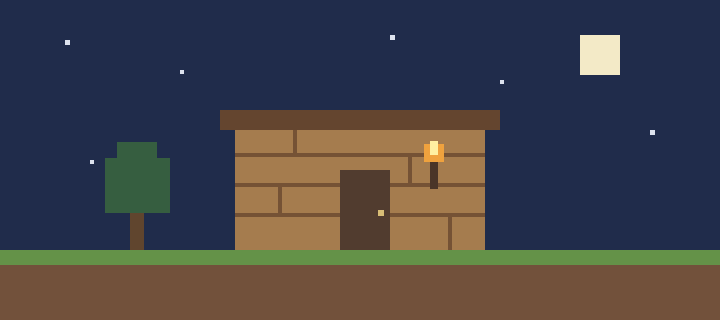

# První noc v Minecraftu

Začít nový svět je v pohodě. Horší je zjistit, že už zapadá slunce a já pořád vybírám místo na barák. Takže tady je krátká příručka, jak první noc nějak zvládnout.



*Na první večer stačí něco takového. Okna a terasa počkají.*

## Co udělat přes den

Nejdřív je potřeba **dřevo a základní nástroje**. Diamanty jsou sice hezký plán, ale bez krumpáče je to zatím jen plán.

1. Natěžit pár kusů dřeva.
2. Vyrobit prkna, pracovní stůl a nástroje.
3. Sehnat kámen a něco k jídlu.
4. Najít místo na úkryt, než bude tma.

### Můj seznam na první večer

- [x] Najít stromy.
- [x] Vyrobit pracovní stůl.
- [ ] Dodělat střechu.
- [ ] Osvětlit úkryt.
- [ ] Přestat odbíhat za každou jeskyní.

## Kde přespat

### Výběr základny

Nemusí to být žádná vila. **Uzavřený a osvětlený úkryt** je na začátek lepší než rozestavěný palác. Hlavně nenechat díru ve střeše, na tu se snadno zapomene.

| Úkryt | Co je na něm dobré | Co mi vadí |
| --- | --- | --- |
| Díra ve svahu | Je rychle hotová | Uvnitř není moc místa |
| Dřevěná chatka | Dá se později rozšířit | Musím nasbírat víc materiálu |
| Provizorní domek z hlíny | Materiál je skoro všude | No, moc hezký není |

### Když už je tma

Zalézt dovnitř, zavřít vchod a dát si dohromady věci. ~~Ještě jen na minutku ven pro dřevo.~~ Tohle většinou skončí hledáním ztracených věcí.

## Malá kontrola zásob v Pythonu

Tohle je jen jednoduchá pomůcka mimo hru. Počty si přepíšu podle svého inventáře.

```python
zasoby = {"dřevo": 12, "jídlo": 3, "pochodně": 0}

for vec, pocet in zasoby.items():
    if pocet == 0:
        print(f"Ještě mi chybí: {vec}")
    else:
        print(f"{vec}: {pocet} ks")
```

## Když si nevím rady

Recepty a další informace se dají dohledat na [Minecraft Wiki](https://minecraft.wiki/). Samotnou hru najdu na [oficiálním webu Minecraftu](https://www.minecraft.net/).

První základna nemusí vypadat skvěle. *Když ráno pořád stojí a já mám svoje věci, beru to jako úspěch.*
